# Workshop: Algorithm and Flowchart

For each question in this workshop, you must complete **two** things:

1.  **Write the pseudocode**
2.  **Draw the flowchart** using either
    - **Option 1:** Draw.io (recommended) → export image → upload to
      your repository → link it in this file
    - **Option 2 (optional):** Write a Mermaid flowchart directly in
      Markdown
    - **Option 3 (optional):** Any other valid method

👉 **IMPORTANT:** At the **bottom of each question**, add the
following sections:

### ✔ Pseudocode

### ✔ Flowchart

---

## 1. Check Even or Odd Number

Design an algorithm and flowchart that take a number as input and
determine whether it is even or odd.

### ✔ Pseudocode

```text
START
    INPUT number
    IF number % 2 == 0 THEN
        PRINT Even
    ELSE
        PRINT Odd
    ENDIF
END
```

### ✔ Flowchart

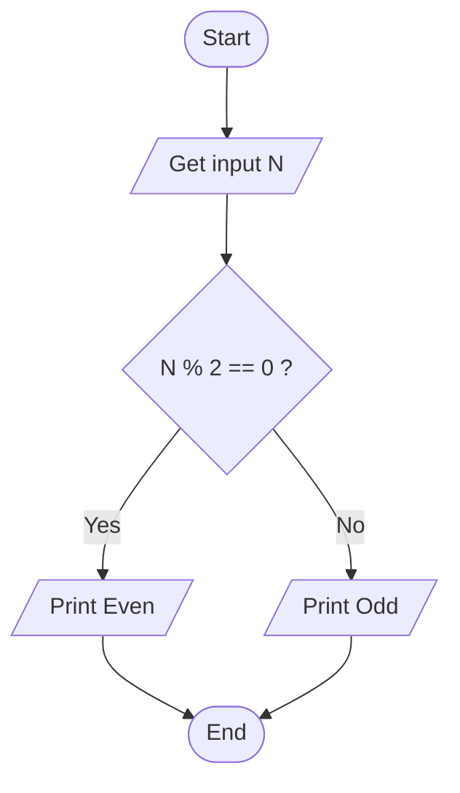

---

## 2. Calculate Total and Average Marks

Write the algorithm and draw the flowchart for a program that inputs
marks for 3 subjects, calculates the total and average, and displays
both.

### ✔ Pseudocode

```text
START

    DECLARE mark1, mark2, mark3, total AS REAL
    DECLARE average AS REAL

    PRINT "Enter marks for Subject 1:"
    INPUT mark1
    
    PRINT "Enter marks for Subject 2:"
    INPUT mark2
    
    PRINT "Enter marks for Subject 3:"
    INPUT mark3

    total = mark1 + mark2 + mark3
    average = total / 3

    PRINT "Total Marks: ", total
    PRINT "Average Marks: ", average

END
```
### ✔ Flowchart

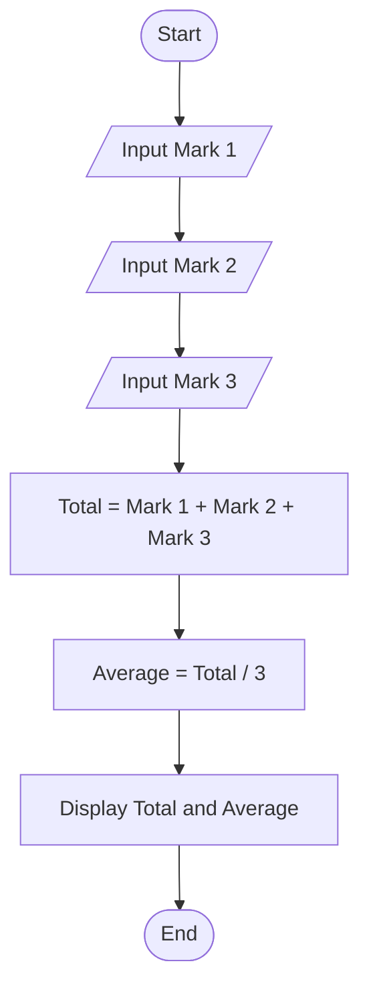

---

## 3. Display Multiplication Table

Create an algorithm and flowchart that input a number and display its
multiplication table from 1 to 10 using a loop.

### ✔ Pseudocode

```text
START

    DECLARE number, counter, product AS INTEGER

    PRINT "Enter a number to generate its multiplication table:"
    INPUT number

    PRINT "Multiplication Table for ", number, ":"

    FOR counter FROM 1 TO 10 STEP 1 DO
        product = number * counter
        PRINT number, " x ", counter, " = ", product
    END FOR

END
```
### ✔ Flowchart

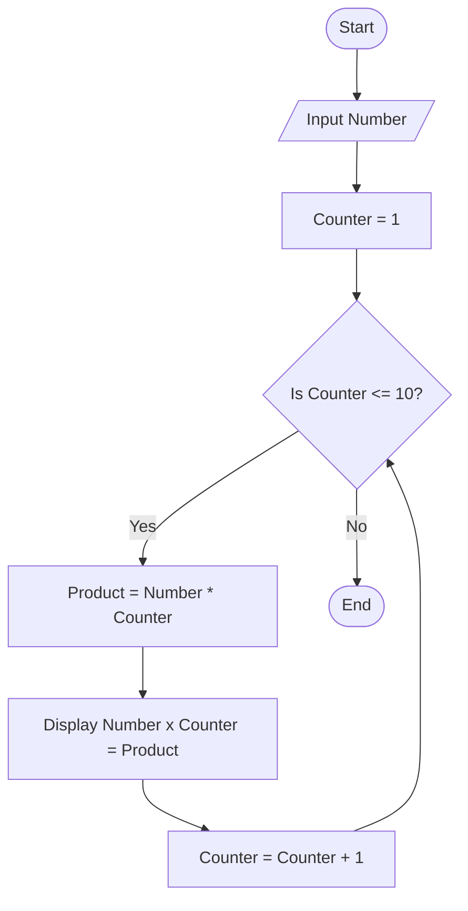
---

## 4. Positive, Negative, or Zero Check

Write the algorithm and flowchart to input a number and display whether
it is positive, negative, or zero.

### ✔ Pseudocode

```text
START

    DECLARE number AS REAL

    PRINT "Enter a number:"
    INPUT number

    IF number > 0 THEN
        PRINT "The number is positive."
    ELSE IF number < 0 THEN
        PRINT "The number is negative."
    ELSE
        PRINT "The number is zero."
    END IF

END
```
### ✔ Flowchart

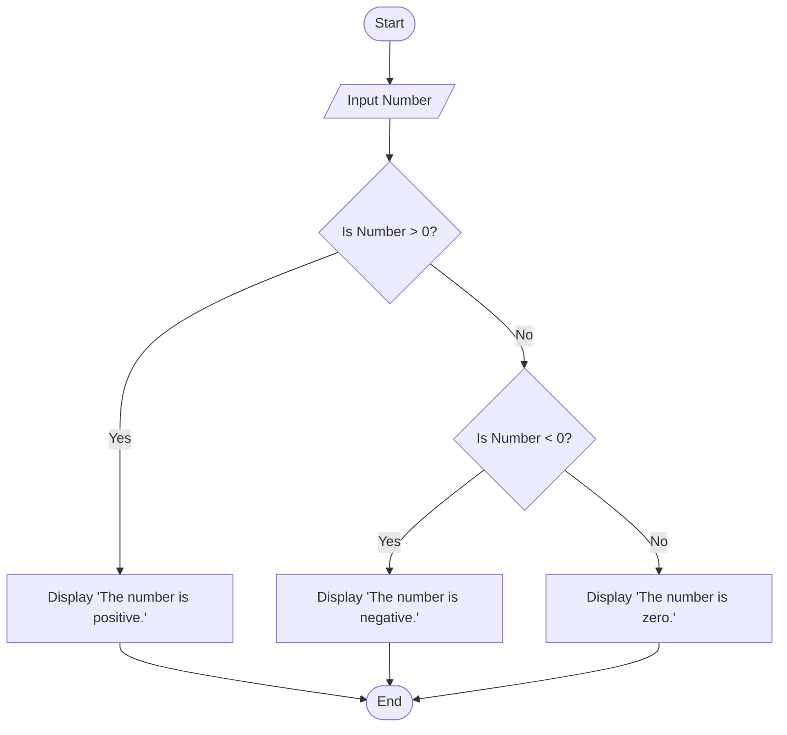

---

## 5. Simple Interest Calculator

Create an algorithm and flowchart for a program that calculates simple
interest using the formula:

**SI = (P × R × T) / 100**

- **P = Principal** → original amount of money
- **R = Rate of Interest** → percentage per year
- **T = Time** → number of years


### ✔ Pseudocode

```text
START

    DECLARE principal, rate, time, simple_interest AS REAL

    PRINT "Enter the principal amount (P):"
    INPUT principal
    
    PRINT "Enter the annual interest rate in percent (R):"
    INPUT rate
    
    PRINT "Enter the time period in years (T):"
    INPUT time

    simple_interest = (principal * rate * time) / 100

    PRINT "The Simple Interest is: ", simple_interest

END
```
### ✔ Flowchart

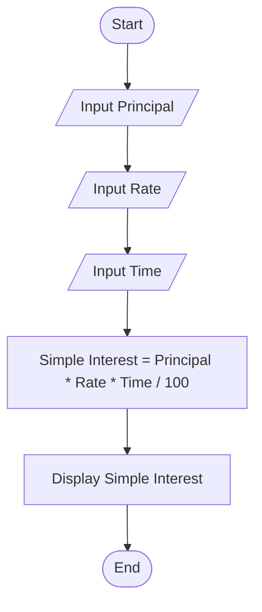
---

## 6. Average Temperature Calculation

Write the algorithm and draw the flowchart for a program that takes the
temperature of 7 days, finds the average temperature, and displays it.

### ✔ Pseudocode

```text
START

    DECLARE total_temp, current_temp, average_temp AS REAL
    DECLARE day_counter AS INTEGER

    total_temp = 0.0

    FOR day_counter FROM 1 TO 7 STEP 1 DO
        PRINT "Enter the temperature for Day ", day_counter, ":"
        INPUT current_temp        
        total_temp = total_temp + current_temp
    END FOR

    average_temp = total_temp / 7

    PRINT "The average temperature for the 7 days is: ", average_temp

END
```
### ✔ Flowchart

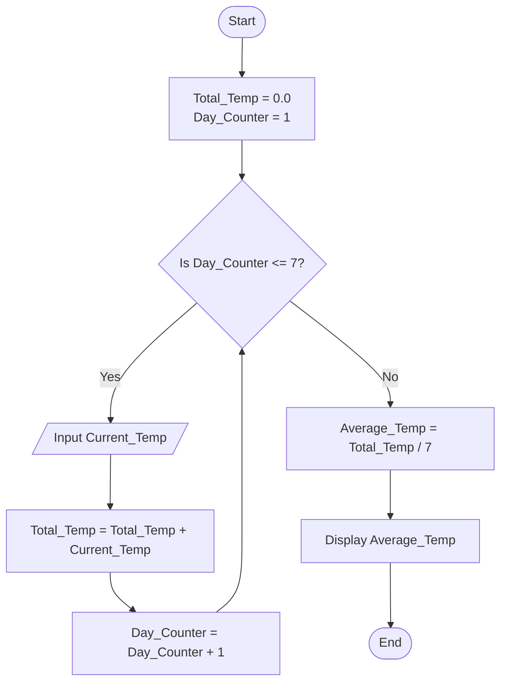
---

## 7. Calculate Area of a Rectangle

Create an algorithm and flowchart to input length and width, calculate
the area (**Area = Length × Width**), and display the result.

### ✔ Pseudocode

```text
START

    DECLARE length, width, area AS REAL

    PRINT "Enter the length:"
    INPUT length
    
    PRINT "Enter the width:"
    INPUT width

    area = length * width

    PRINT "The calculated Area is: ", area

END
```
### ✔ Flowchart

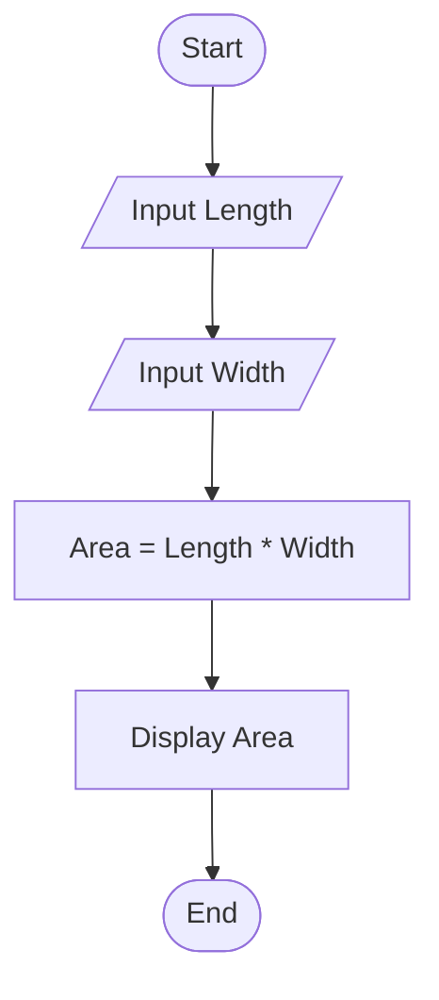
---

## 8. Determine Pass or Fail

Write the algorithm and draw the flowchart for a program that takes a
student's average marks and displays **"Pass"** if average ≥ 50,
otherwise **"Fail"**.

### ✔ Pseudocode

```text
START

    DECLARE average AS REAL

    PRINT "Enter the student's average marks:"
    INPUT average

    IF average >= 50 THEN
        PRINT "Pass"
    ELSE
        PRINT "Fail"
    END IF

END
```
### ✔ Flowchart

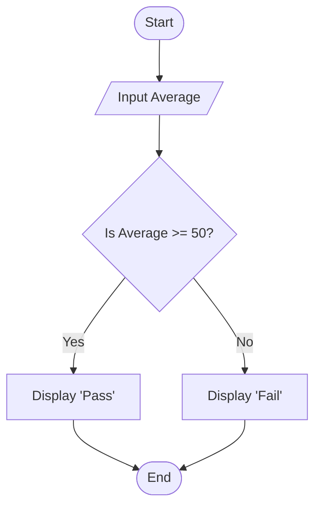
---

## 9. Calculate Factorial of a Number

Write the algorithm and draw the flowchart that input a number and
calculate its factorial using a loop.

### ✔ Pseudocode

```text
START

    DECLARE number, counter AS INTEGER
    DECLARE factorial AS LONG_INTEGER
    
    factorial = 1
    
    PRINT "Enter an integer:"
    INPUT number

    FOR counter FROM 1 TO number STEP 1 DO
        factorial = factorial * counter
    END FOR
    
    PRINT "The factorial is: ", factorial

END
```
### ✔ Flowchart

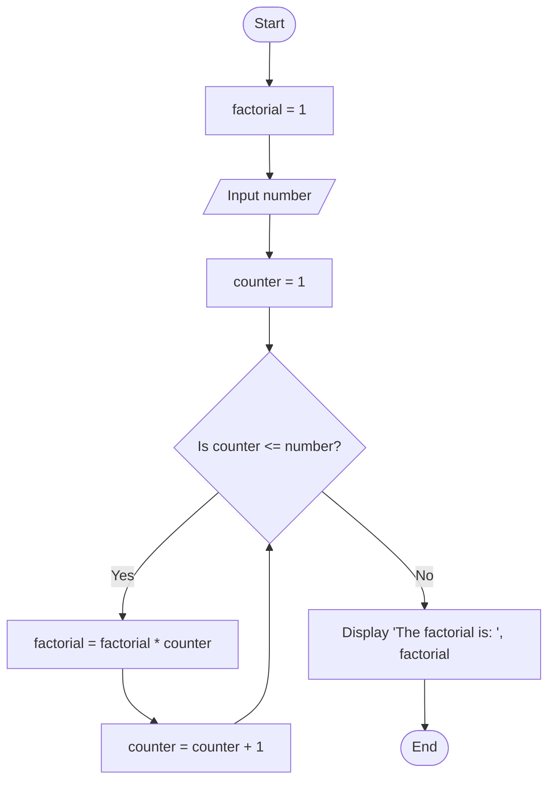
---

## 10. Calculate Discount on Purchase

Write the algorithm and draw the flowchart for a program that inputs the
purchase amount and gives a **10% discount** if the amount is greater
than 1000.

### ✔ Pseudocode

```text
START

    DECLARE purchase_amount, discount, final_amount AS REAL

    PRINT "Enter the total purchase amount:"
    INPUT purchase_amount

    IF purchase_amount > 1000 THEN
        discount = purchase_amount * 0.10
    ELSE
        discount = 0
    END IF

    final_amount = purchase_amount - discount

    PRINT "Discount applied: ", discount
    PRINT "Final amount to pay: ", final_amount

END
```
### ✔ Flowchart

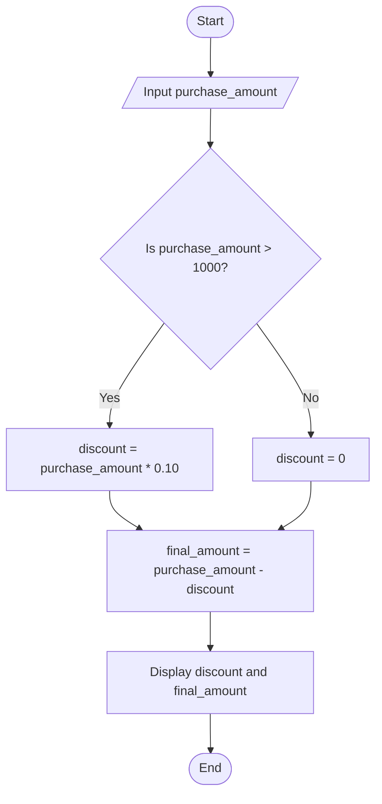
---


## Optional Exercises (11–16)

## 11. Online Shopping Delivery Eligibility

Write the algorithm and draw the flowchart for a program that inputs a
customer's purchase amount and displays **"Free Delivery"** if the
amount is 500 SEK or more; otherwise display **"Delivery Charge
Applies"**.

### ✔ Pseudocode

```text
START

    DECLARE purchase_amount AS REAL

    PRINT "Enter the total purchase amount (SEK):"
    INPUT purchase_amount

    IF purchase_amount >= 500 THEN
        PRINT "Free Delivery"
    ELSE
        PRINT "Delivery Charge Applies"
    END IF

END
```
### ✔ Flowchart

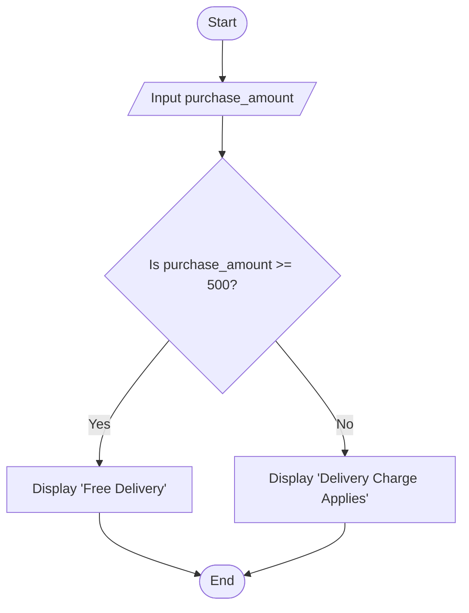
---

## 12. Employee Salary and Bonus Calculator

Write the algorithm and draw the flowchart for a program that inputs an
employee's monthly salary and years of service, calculates a bonus of
**10%** for employees with 5 or more years of service and **5%** for
others, then displays the bonus and total salary.

### ✔ Pseudocode

```text
START

    DECLARE monthly_salary, bonus, total_salary AS REAL
    DECLARE years_of_service AS INTEGER

    PRINT "Enter the employee's monthly salary:"
    INPUT monthly_salary
    
    PRINT "Enter the employee's years of service:"
    INPUT years_of_service

    IF years_of_service >= 5 THEN
        bonus = monthly_salary * 0.10
    ELSE
        bonus = monthly_salary * 0.05
    END IF

    total_salary = monthly_salary + bonus

    PRINT "Calculated Bonus: ", bonus
    PRINT "Total Salary (including bonus): ", total_salary

END
```
### ✔ Flowchart

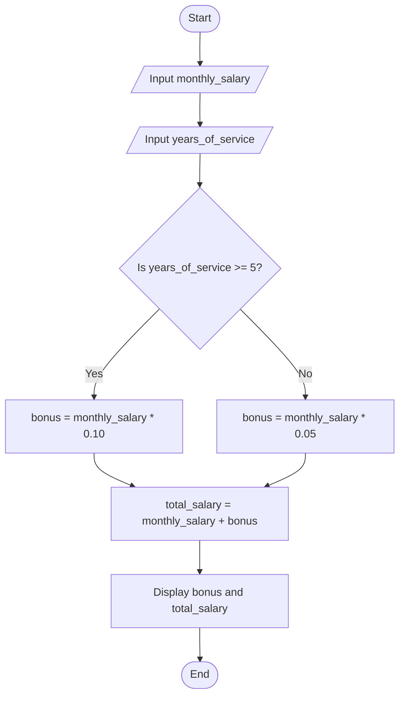
---

## 13. Mobile Data Usage Monitor

Write the algorithm and draw the flowchart for a program that inputs a
user's monthly data limit and data usage, then displays whether the user
has exceeded the limit or how much data remains.

### ✔ Pseudocode

```text
START

    DECLARE data_limit, data_usage, remaining_data AS REAL

    PRINT "Enter your monthly data limit (in GB):"
    INPUT data_limit
    
    PRINT "Enter your data usage so far (in GB):"
    INPUT data_usage

    IF data_usage > data_limit THEN
        PRINT "You have exceeded your monthly data limit!"
    ELSE
        remaining_data = data_limit - data_usage
        PRINT "You have ", remaining_data, " GB remaining for this month."
    END IF

END
```
### ✔ Flowchart

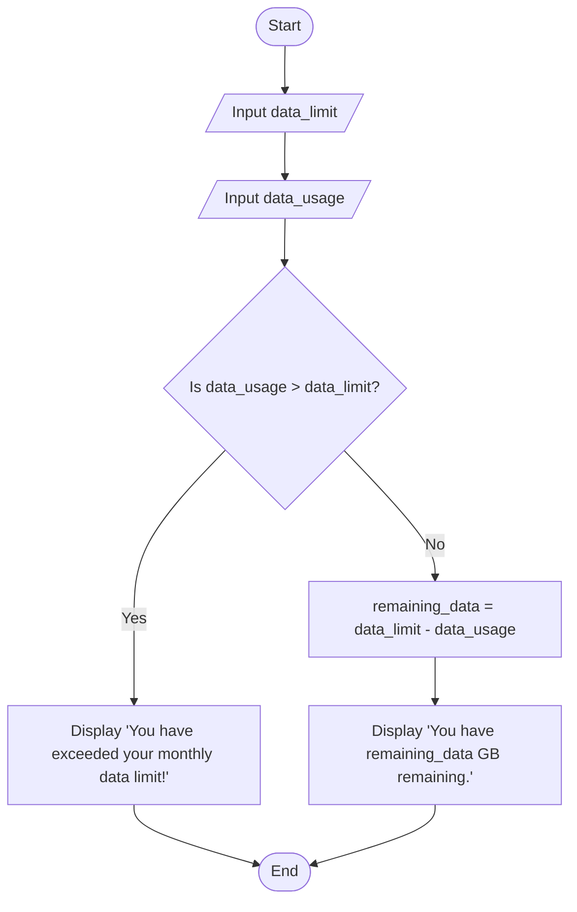
---

## 14. Login System (Maximum 3 Attempts)

Create an algorithm and flowchart for a login system that allows a user
up to 3 attempts to enter the correct password. Display **"Access
Granted"** if the password is correct; otherwise display **"Account
Locked"** after 3 failed attempts.

### ✔ Pseudocode

```text
START

    DECLARE correct_password, entered_password AS STRING
    DECLARE attempts AS INTEGER
    DECLARE login_success AS BOOLEAN
    
    correct_password = "Password123" 
    attempts = 0
    login_success = FALSE

    WHILE login_success == FALSE AND attempts < 3 DO
        PRINT "Enter your password:"
        INPUT entered_password
        
        IF entered_password == correct_password THEN
            login_success = TRUE
        ELSE
            attempts = attempts + 1
            PRINT "Incorrect password. Attempts remaining: ", (3 - attempts)
        END IF
    END WHILE

    IF login_success == TRUE THEN
        PRINT "Access Granted"
    ELSE
        PRINT "Account Locked"
    END IF

END
```
### ✔ Flowchart

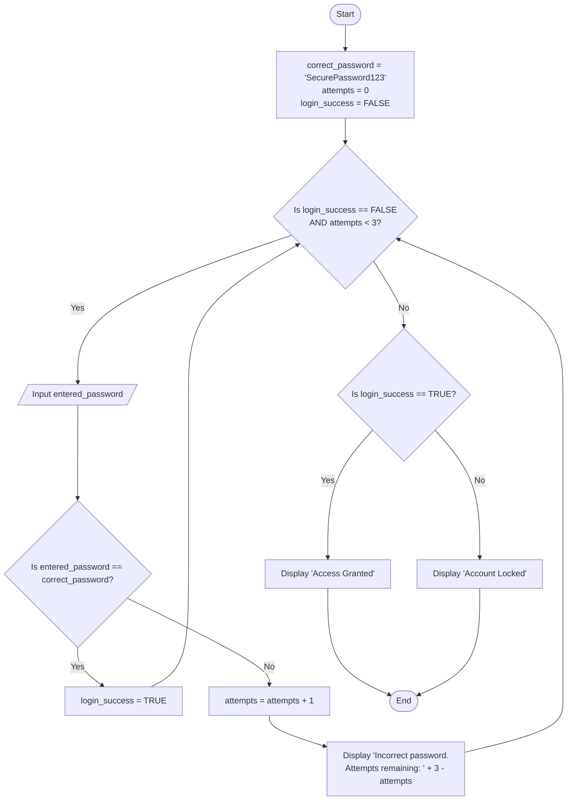
---

## 15. Store Checkout with Multiple Items

Write the algorithm and draw the flowchart for a program that inputs the
number of items purchased, calculates the total purchase amount using a
loop, and applies a **15% discount** if the total exceeds 5000 SEK.

### ✔ Pseudocode

```text
START

    DECLARE total_items, counter AS INTEGER
    DECLARE item_price, total_amount, discount, final_amount AS REAL

    total_amount = 0.0

    PRINT "Enter the number of items purchased:"
    INPUT total_items

    FOR counter FROM 1 TO total_items STEP 1 DO
        PRINT "Enter the price for item ", counter, ":"
        INPUT item_price
        
        total_amount = total_amount + item_price
    END FOR

    IF total_amount > 5000 THEN
        discount = total_amount * 0.15
    ELSE
        discount = 0.0
    END IF

    final_amount = total_amount - discount

    PRINT "Subtotal: ", total_amount, " SEK"
    PRINT "Discount Applied: ", discount, " SEK"
    PRINT "Final Bill: ", final_amount, " SEK"

END
```
### ✔ Flowchart

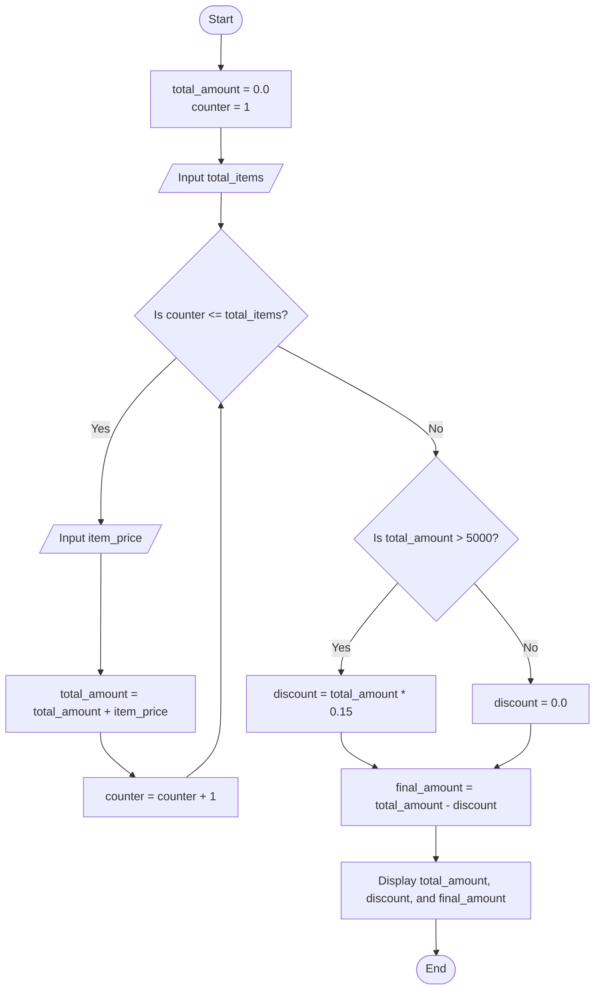
---

## 16. Electricity Bill Calculator

Write the algorithm and draw the flowchart for a program that inputs the
number of electricity units consumed and calculates the total bill using
the following rates: first 100 units at 1.5 SEK per unit, next 200
units at 2.0 SEK per unit, and all remaining units at 3.0 SEK per unit.

### ✔ Pseudocode

```text
START

    DECLARE units, total_bill AS REAL

    PRINT "Enter the number of electricity units consumed:"
    INPUT units

    IF units <= 100 THEN
        total_bill = units * 1.5
    ELSE IF units <= 300 THEN
        total_bill = (100 * 1.5) + ((units - 100) * 2.0)
    ELSE
        total_bill = (100 * 1.5) + (200 * 2.0) + ((units - 300) * 3.0)
    END IF

    PRINT "Total Electricity Bill: ", total_bill, " SEK"

END
```
### ✔ Flowchart

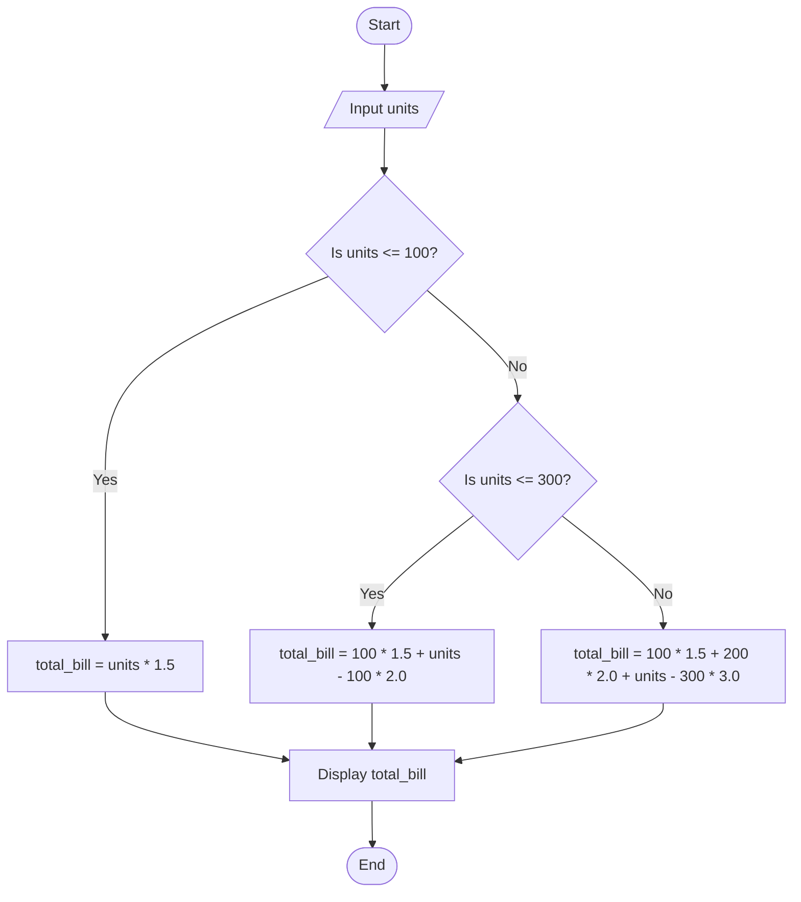
---
